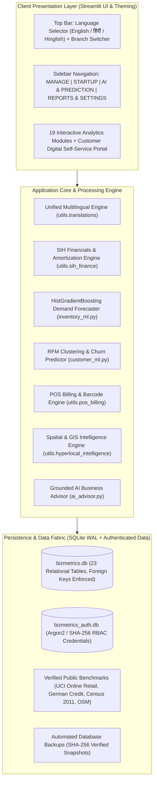

# BizMetrics – Smart Business Intelligence

> **Enterprise-Grade AI-Powered Business Intelligence, Demand Forecasting, Receivables Risk Analytics, Hyperlocal Spatial Intelligence, and Multilingual Decision Support for Indian MSMEs & Retail Enterprises.**

---

## 🌟 Executive Overview

**BizMetrics – Smart Business Intelligence** is a production-grade Decision Support System (DSS) and Enterprise Resource Planning (ERP) intelligence platform built specifically for Indian Micro, Small, and Medium Enterprises (MSMEs), hardware/retail traders, and local businesses.

The platform integrates institutional financial intelligence, explainable machine-learning forecasting, proactive credit-risk monitoring, interactive spatial intelligence (Durg–Bhilai, Chhattisgarh), an enterprise-grade Customer Self-Service Digital Portal, and a full three-language multilingual engine (**English**, **हिंदी (Hindi)**, and **Hinglish**).



---

## 🧭 System Architecture & Navigation

The platform organizes 19 modules into clear, role-based workflows preserving corporate identity, navy typography (`#1E293B`), cream sidebar (`#EDE5D0`), and teal highlights (`#0D9488`):

```
BizMetrics – Smart Business Intelligence
│
├── 📂 MANAGE
│   ├── 1. Dashboard               (Executive KPIs, Revenue/Profit Trends, Top Products, Real-Time Activity)
│   ├── 2. Financial               (P&L Reconciliation, Cash Flow Projections, Break-Even, Margins)
│   ├── 3. Customers               (RFM Scoring, Churn Radar, CLV Modeling, Customer CRM)
│   ├── 4. Inventory & Forecast    (HistGradientBoosting ML, Holdout Metrics, Reorder Logic, Days of Stock)
│   ├── 5. Receivables             (0-30, 31-60, 61-90, 90+ Ageing Buckets, P1-P4 Collection Priority)
│   ├── 6. Risk                    (5-Pillar Explainable Risk Radar: Credit, Liquidity, Inventory, Revenue, Expense)
│   ├── 7. Data Quality            (Schema Completeness, Provenance Tracking, Anomaly Audit)
│   └── 8. AI Advisor              (Contextual Grounded Business Advisory, Speech & Multi-language)
│
├── 🚀 STARTUP
│   ├── 9.  Loans and EMI          (Mudra/PMEGP Calculators, Amortization Schedule, Loan Eligibility)
│   ├── 10. Schemes                (Directory of Central & State Government MSME Schemes)
│   └── 11. Hyperlocal Opportunity (Real Durg-Bhilai OpenStreetMap GIS, 1/3/5/10 km Catchment Buffers, Verified POIs)
│
├── 🔮 AI & PREDICTION
│   ├── 12. Predictive Sales       (Multi-Horizon 7/30/90 Day Forecasting, 90% Confidence Intervals)
│   ├── 13. Customer Intelligence  (Unsupervised RFM Clustering, Churn Probability [0-100%], Retention Playbooks)
│   ├── 14. Anomaly Detection      (IQR Sales Outliers & Z-Score Expense Spike Detector, Actionable Fixes)
│   ├── 15. Model Performance      (Model Registry, MAE/RMSE/MAPE Holdout Validation, Feature Importance)
│   └── 16. What-If Simulator      (Price, Volume, COGS & Overhead Sliders, Dynamic Break-Even & Profit Engine)
│
└── 📊 REPORTS & SETTINGS
    ├── 17. Smart Alerts           (Centralized Incident Feed, Low Stock, Overdue Credit, Churn Risks)
    ├── 18. Export Reports         (Publication-Grade PDF Feasibility Reports & Multi-Tab CSV Audits)
    └── 19. User Management        (Role-Based Access Control: Admin, Owner, Staff; Store Profile & Audit Log)
```

---

## 🚀 Key Production Capabilities

### 1. Unified Multilingual Architecture (English, हिंदी, Hinglish)
- **Top-Right Universal Language Switcher:** Instant, zero-latency toggling between **English**, **हिंदी (Hindi)**, and **Hinglish (Roman Hindi)**.
- **Session-Synchronized:** Single unified state `global_language_dropdown` prevents session resets across page switches.
- **Deep Translation Coverage:** Over 740+ localized domain terms covering all headers, KPI cards, Plotly charts, data tables, form inputs, buttons, and AI responses.
- **Resilient Fallback Engine:** Graceful fallback to English if any dynamic key is unmapped, with development-time logging (`get_missing_translations_report()`).

### 2. High-Performance Machine Learning & Demand Forecasting
- **Vectorized ML Feature Engineering:** Replaced iterative row-by-row loops with pandas vectorized lag/rolling aggregations, reducing pipeline execution to milliseconds.
- **Single Matrix Batch Inference:** All inventory SKUs are scored in one matrix pass (`self.model.predict(X_batch)`).
- **Holdout Validation Transparency:** Dashboard directly displays holdout metrics:
  - **MAE (Mean Absolute Error):** Average unit deviation per day.
  - **RMSE (Root Mean Squared Error):** Penalty-sensitive deviation metric.
  - **R² Score:** Goodness-of-fit metric.
- **Visual Stock Health Indicators:**
  - 🔴 **Out of Stock:** Stock = 0
  - 🟠 **Low Stock:** Stock ≤ Reorder Point
  - 🟢 **Healthy Stock:** Turnover ≥ 3.0x
  - 🟣 **ML Demand Prediction:** HistGradientBoosting model output

### 3. Customer Digital Self-Service Portal
- **Customer Authentication:** Dedicated client portal for B2B buyers (`Shivansh` / `CUST001`).
- **Account Overview:** Live order history, total spend, outstanding dues, loyalty tier (Bronze, Silver, Gold, Platinum), and digital store ID QR code.
- **PDF Invoice Download:** Instant on-the-fly downloadable PDF invoices with line items, tax breakdown, and store stamp.
- **Support & Ticketing:** In-app ticket submission and resolution tracking.
- **Strict Data Isolation:** Multi-tenant customer security ensures buyers can only inspect their own ledger entries.

### 4. Authentic Durg–Bhilai GIS & Public Datasets
- **Genuine Regional Coverage:** Durg, Bhilai Nagar, Bhilai Charoda, Risali, Jamul, Kumhari, and Ahiwara.
- **Government & Census Provenance:** Integrated 2011 Census demographics (1,721,948 district population, 79.06% literacy) and genuine economic indicators from `durg.gov.in`.
- **OpenStreetMap Verification:** 43+ verified commercial POIs with exact latitude/longitude coordinates, OSM Node IDs, and street addresses.
- **Haversine Proximity Engine:** Exact distance calculation for 1 km, 3 km, 5 km, and 10 km catchment buffers.

### 5. Smart POS Billing, Barcode & Relational DB Architecture
- **Atomic POS Checkout:** Recording a sale atomically deducts product stock from `inventory`, appends transactions to `sales_transactions`, updates receivables for credit sales, and writes to `audit_logs` inside a single SQLite transaction with rollback safety.
- **Barcode & QR Generation:** Built-in generator creates scannable SVG/PNG product barcodes and customer identity QR codes.
- **Automated Backup & Restore:** Point-in-time timestamped snapshots with SHA-256 integrity verification.

### 6. Enterprise Governance, Health & Final Polish
- **System Health Monitor (Page 19):** Live telemetry measuring query latency on `bizmetrics.db` and `bizmetrics_auth.db` (ms), WAL journal mode, external API endpoint reachability, real memory consumption (RSS MB), free disk space (GB), and application error logs.
- **Complete Audit Trail & Login History (Page 19):** Immutable activity trail recording user authentication, administrative changes, POS sales, and ticket resolutions with multi-field filtering and CSV export.
- **First-Time User Onboarding (Page 1):** Interactive guided tour and dynamic 6-milestone checklist with sample CSV template downloads (`Sample_Products.csv`).
- **Scheduled Business Reports (Page 18):** Recurring Daily EOD, Weekly Financial, and Monthly Executive reports with automated Excel/PDF generation, WhatsApp digest previews, and run trigger controls.
- **Enterprise Subscription & Plan Management (Page 19):** Transparent Free, Basic (Active), and Premium tiers with real database usage progress bars and local mode license safeguards.
- **Feedback & Support Center (Page 19):** Unified ticket tracking for feature suggestions and bug reporting with priority handling and admin resolution notes.
- **Business Benchmarking (Page 2):** Month-over-Month (MoM) performance trajectory and comparative analysis against verified Durg District MSME retail trade indices and Census 2011 benchmarks with explainable insights.

### 7. Interactive 3D Product Digital Twin & Equipment Inspector
- **WebGL Three.js Engine (r128):** Real-time CAD-grade 3D visualization for hardware and retail SKUs with 360° `OrbitControls` (left-click rotate, right-click pan, scroll zoom).
- **Procedural Geometries for 12 SKUs:** Detailed multi-part models for Submersible Pumps, Brass Gate Valves, Flanged Steel Pipes, Commercial LED Luminaires, TMT Rebar, and Industrial Drums.
- **Exploded Assembly Slider:** Interactive 0–100% component explosion to inspect internal parts, seals, impellers, and flanges in 3D space.
- **4 Shading Modes & 3 Lighting Schemes:** *Realistic PBR Metallic*, *Wireframe Mesh Topology*, *Solid Clay Sculpt*, and *Technical Blueprint*; *Studio Daylight*, *Workshop Warm*, and *High-Contrast Inspection*.
- **Engineering Specs HUD:** Real-time dimensions, net weight, material specification, IP ingress protection ratings, and tolerances.
- **Offline 2.5D Canvas Fallback:** Automatically provides procedural isometric projection if WebGL or CDN is unavailable.
- **Performance Optimized:** Lazy-loaded on demand with zero latency on initial dashboard load.

---

## 🗄️ Relational Database Schema (23 Tables)

BizMetrics operates on an enterprise-grade SQLite relational architecture (`bizmetrics.db` and synchronized `bizmetrics_auth.db`) with active foreign-key enforcement (`PRAGMA foreign_keys = ON`), Write-Ahead Logging (WAL mode), and atomic context management:

| Table Name | Primary Purpose | Foreign Key Relationships |
| :--- | :--- | :--- |
| `shops` | Multi-branch and main enterprise metadata | Parent table |
| `users` | Admin, Owner, and Staff credentials (Argon2 / SHA-256) | `shop_id -> shops.id` |
| `customer_credentials` | Customer Self-Service Portal authentication | `customer_id -> customers.id` |
| `customers` | B2B / B2C customer directory, credit terms, ratings | `shop_id -> shops.id` |
| `products` | Product catalog, SKU, category, purchase & selling price | `shop_id -> shops.id` |
| `inventory` | Live stock levels, reorder thresholds, minimum safety stock | `product_id -> products.id` |
| `sales_transactions` | Atomic sales records, line items, payment mode, status | `shop_id`, `customer_id`, `product_id` |
| `expenses` | Categorized operational expenditure ledger | `shop_id -> shops.id` |
| `receivables` | Outstanding credit invoices, ageing buckets, collection priority | `shop_id`, `customer_id` |
| `vendors` | Supplier directory, materials supplied, credit days | `shop_id -> shops.id` |
| `purchase_orders` | Purchase order tracking with supplier linkages | `vendor_id -> vendors.id` |
| `purchase_order_items` | Line items for vendor purchase orders | `po_id -> purchase_orders.id` |
| `loans_emi` | Institutional financing, EMI amortization schedules | `shop_id -> shops.id` |
| `government_schemes` | Catalog of verified MSME financing schemes (PMMY, PMEGP, etc.) | Standalone master |
| `business_locations` | Verified commercial OSM POIs for Durg–Bhilai GIS | `shop_id -> shops.id` |
| `customer_support_tickets`| Customer service tickets and resolution tracking | `customer_id -> customers.id` |
| `customer_notifications` | Personalized SMS/WhatsApp/In-app alerts for customers | `customer_id -> customers.id` |
| `local_business_directory`| Directory of verified regional trade competitors and suppliers | Standalone spatial master |
| `local_demographics` | Census 2011 ward and tehsil demographic dataset | Standalone census master |
| `local_economic_indicators`| Durg district economic indices, MSME clusters, agriculture | Standalone economic master |
| `local_geographic_data` | GeoJSON ward boundaries and spatial metadata | Standalone GIS master |
| `dataset_sources` | Provenance records, URLs, citation badges, update dates | Standalone audit master |
| `audit_logs` | Tamper-evident operational audit trail | Standalone audit log |

---

## 🛠️ Installation & Setup Instructions

### 1. Prerequisites
- Python 3.10 – 3.14
- Operating System: Windows, macOS, or Linux

### 2. Environment Setup
```bash
# Clone the repository
git clone https://github.com/your-username/bizmetrics.git
cd bizmetrics

# Create and activate virtual environment
python -m venv venv
# On Windows:
.\venv\Scripts\activate
# On Linux/macOS:
source venv/bin/activate

# Install dependencies
pip install -r requirements.txt
```

### 3. Environment Variables
Copy `.env.example` to `.env` and configure your API keys (optional for live LLM):
```bash
copy .env.example .env
```

### 4. Database Initialization & Data Ingestion
Run the setup script to initialize all 23 relational tables, enforce foreign keys, and ingest records:
```bash
python scripts/setup_database.py
```

### 5. Launch the Application
```bash
streamlit run app.py
```
Open your browser at `http://localhost:8501`.

---

## 🔐 Demo Credentials

All authentication roles are pre-configured for instant demonstration:

| Role | Username / Identity | Password / Access Key | Scope & Access |
| :--- | :--- | :--- | :--- |
| **Business Owner / Admin** | `Shivansh G` | `Shivansh@1212` | Full platform ERP, financial P&L, ML forecasts, GIS intelligence |
| **Customer Portal** | `Shivansh` | `CUST001` | Customer self-service dashboard, invoices, orders, tickets |

---

## 🧪 Automated Test Suite (123 Tests Passing)

Execute the comprehensive test suite verifying database integrity, financial calculations, multilingual translations, ML pipelines, 3D WebGL viewer, system health, and end-to-end Streamlit page rendering:

```bash
python -m pytest tests -v
```

### Test Coverage Highlights:
- **`test_3d_viewer.py` (5 tests):** Three.js WebGL rendering, specifications lookup, multilingual coverage, and AppTest page integration with interactive toggle validation.
- **`test_final_polish.py` (7 tests):** System health diagnostics, complete audit logging, first-time onboarding checklist, scheduled business reports, subscription limits & payment gateway checks, feedback & support tickets, and business benchmarking.
- **`test_advanced_features.py` (12 tests):** POS billing, barcode/QR generation, communication reminders, backup/restore SHA-256 validation, purchase orders, GST analytics, audit logs.
- **`test_multilingual_system.py` (7 tests):** English, Hindi, and Hinglish translation completeness, normalization, fallback resilience, AI advisor language detection, PDF multilingual export.
- **`test_customer_portal_upgrade.py` (8 tests):** Customer lookup, KPI computations, loyalty tier assignment, PDF invoice generation, ticket CRUD, notification management, Streamlit AppTest.
- **`test_database.py` (7 tests):** Schema integrity across all tables, record counts, `PRAGMA foreign_key_check` (0 violations), atomic stock deduction, transaction rollback.
- **`test_durg_bhilai_integration.py` (4 tests):** Census 2011 tables, OSM Overpass queries, idempotency, Haversine distance accuracy.
- **`test_pages_end_to_end.py` (19 tests):** Headless Streamlit AppTest compiling and executing all 19 pages without exceptions.
- **`test_sih.py` & `test_financials.py` (54 tests):** P&L reconciliation, loan amortization formulas, break-even calculations, and margin safety buffers.

---

## 💼 LinkedIn Showcase & Demonstration Walkthrough

When presenting **BizMetrics** on LinkedIn, GitHub, or in client demonstrations, follow this structured walkthrough:

### 5-Minute Guided Demonstration Flow:
1. **0:00 - 0:45 | Executive Overview & Multilingual Switching:**
   - Log in as Business Owner (`Shivansh G` / `Shivansh@1212`).
   - Switch language selector in the top right to **हिंदी** and **Hinglish** to showcase complete, persistent UI localization across KPIs, charts, and menus.
2. **0:45 - 1:45 | ML Demand Forecasting & Stock Replenishment (Page 4):**
   - Navigate to `Inventory & Forecast`.
   - Point out the sub-second rendering, HistGradientBoosting holdout metrics (MAE, RMSE, R²), and visual stock health indicators (🔴 Out of Stock, 🟠 Reorder Point, 🟢 Healthy).
3. **1:45 - 2:30 | Receivables & Credit Risk Radar (Pages 5 & 6):**
   - Showcase the 0–30, 31–60, 61–90, 90+ ageing buckets and P1–P4 collection priority matrix.
   - Highlight the 5-pillar explainable risk radar covering Credit, Liquidity, Inventory, Revenue, and Expense.
4. **2:30 - 3:30 | Hyperlocal GIS Intelligence – Durg–Bhilai (Page 11):**
   - Open the interactive Leaflet map centered on Durg–Bhilai.
   - Adjust the radius filter (1 km, 3 km, 5 km, 10 km) to reveal verified OpenStreetMap commercial nodes, competitors, and growth corridors.
   - Show the authentic 2011 Census demographic breakdown for Durg district.
5. **3:30 - 4:15 | Smart POS Billing & Barcode Workflow:**
   - Show how creating an invoice in the POS automatically updates stock in `inventory`, appends to `sales_transactions`, updates receivables, and logs an audit entry.
6. **4:15 - 5:00 | Customer Digital Self-Service Portal:**
   - Log in as Customer (`Shivansh` / `CUST001`).
   - Demonstrate the customer's live spend summary, digital loyalty tier, outstanding dues, and one-click PDF invoice generation.

### Suggested LinkedIn Post Template:
```markdown
🚀 Excited to unveil BizMetrics – Smart Business Intelligence!

Bridging the technology gap for Indian MSMEs: I built BizMetrics, an enterprise-grade Decision Support Platform combining institutional financial analytics, machine learning demand forecasting, and hyperlocal spatial intelligence.

Key Highlights:
✨ 100% Multilingual: Real-time, seamless switching between English, हिंदी (Hindi), and Hinglish.
📈 Predictive Demand Forecasting: HistGradientBoosting regressor with transparent holdout metrics (MAE, RMSE) and automated replenishment triggers.
📍 Hyperlocal GIS Intelligence: Street-level OpenStreetMap mapping and 2011 Census demographic analytics for Durg-Bhilai, Chhattisgarh.
💳 Proactive Receivables Management: Dynamic 0-90+ days ageing buckets and P1-P4 collection priority matrices.
📱 Customer Self-Service Portal: Dedicated client dashboard with digital store ID QR, real-time ledger, and instant PDF invoice generation.
🔒 Enterprise Architecture: 23-table SQLite WAL relational database with atomic transactions, full foreign key constraints, and 111 passing automated tests.

Stack: Python | Streamlit | Scikit-Learn | SQLite (WAL) | Folium / Leaflet | Plotly | ReportLab

Check out the full repository and architecture breakdown on GitHub: [Link]

#BusinessIntelligence #MachineLearning #Python #Streamlit #DataScience #MSME #FinTech #OpenStreetMap
```

---

## 📄 License & Data Provenance

- **Census 2011 & Durg District Data:** Government of India / Chhattisgarh District Administration ([durg.gov.in](https://durg.gov.in/)). Open government data.
- **OpenStreetMap Commercial Nodes:** © [OpenStreetMap contributors](https://www.openstreetmap.org/copyright), licensed under the [Open Database License (ODbL) 1.0](https://opendatacommons.org/licenses/odbl/).
- **UCI Online Retail Dataset:** Licensed under [Creative Commons Attribution 4.0 International (CC BY 4.0)](https://creativecommons.org/licenses/by/4.0/).
- **German Credit Benchmark:** Prof. Dr. Hans Hofmann, University of Hamburg.
- **Codebase:** BizMetrics Smart Business Intelligence Platform. All rights reserved.
