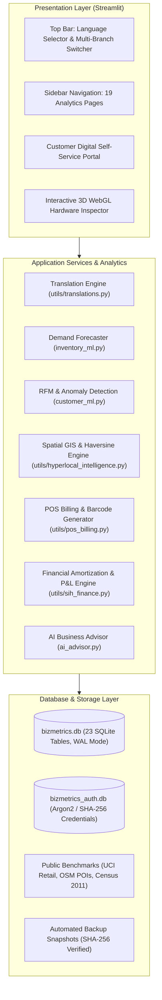

# BizMetrics – Smart Business Intelligence

A modular Python and Streamlit web application providing business analytics, daily sales tracking, inventory demand forecasting, customer receivables (*khata*) aging, and hyperlocal geospatial intelligence for retail and MSME businesses.

---

## 1. Project Title and Description

**BizMetrics – Smart Business Intelligence** is an operational dashboard and decision support application developed in Python and Streamlit. Built specifically with Indian retail merchants and MSMEs in mind—such as hardware stores, building material suppliers, and electrical distributors—the project integrates daily point-of-sale operations with machine learning demand forecasting, credit receivables aging, and regional market intelligence.

---

## 2. Overview and Problem Statement

### The Problem
Micro, small, and medium retail enterprises across Tier-2 and Tier-3 Indian cities frequently track daily sales, credit ledgers (*khata*), and supplier purchases across physical notebooks or ad-hoc spreadsheets.

- **High-End ERPs Are Ill-Suited:** Enterprise ERP platforms (e.g., SAP, Oracle) require extensive configuration, expensive licensing, and complex training, making them impractical for independent store owners.
- **Bookkeeping Apps Are Narrow:** Common mobile bookkeeping applications record cash inflow and outflow, but lack forward-looking analytics such as inventory demand forecasting, dynamic cash flow break-even simulations, and catchment area analysis.
- **Unstructured Credit:** Customer credit (*khata*) is often tracked informally, leading to unmonitored aging balances and delayed receivables recovery.

### The Solution
BizMetrics addresses these operational bottlenecks by providing a unified, local-first analytics dashboard. It combines daily sales logging with Scikit-Learn demand forecasting, automated aging classification for receivables, spatial market analysis for the Durg–Bhilai region, and a self-service customer portal.

---

## 3. Key Features and Actual Implemented Modules

### Key Features
- **Sales & Financial Analytics:** Tracks gross sales, cost of goods sold (COGS), net profit margins, operating expense categories, and daily cash flow projections.
- **Inventory & Demand Forecasting:** Real-time inventory tracking, turnover ratios, reorder threshold alerts, and SKU-level unit demand predictions using Scikit-Learn's `HistGradientBoostingRegressor`.
- **Receivables & Khata Aging:** Categorizes overdue customer credit into 0–30, 31–60, 61–90, and 90+ day aging buckets with prioritized collection queues.
- **Hyperlocal Spatial Intelligence:** Interactive Leaflet map displaying commercial competitors and trade hubs across Durg–Bhilai with 1 km, 3 km, 5 km, and 10 km radius filters and 2011 Census demographic overlays.
- **Customer Self-Service Portal:** Separate customer interface allowing buyers to inspect their transaction history, outstanding balances, loyalty tier, and download PDF invoices.
- **Point-of-Sale (POS) & Barcode Engine:** Atomic checkout routine that records transactions, updates inventory, modifies customer ledgers, and generates printable barcodes/QR codes.
- **3D Hardware Component Inspector:** WebGL Three.js interactive viewer supporting procedural 3D models for industrial hardware SKUs with wireframe, PBR, and exploded view modes.
- **Multilingual Support:** Centralized dictionary translation engine supporting English, Hindi (`हिंदी`), and Hinglish.
- **Automated Document Export:** On-the-fly ReportLab PDF invoice generation, executive business summary exports, and multi-table CSV downloads.
- **Role-Based Access Control:** Separate roles for Owner/Admin, Staff, and Customers backed by salted password hashing.

### Application Modules
BizMetrics is organized into 19 functional pages located in the `pages/` directory:

| # | Module | Source File | Description |
|---|---|---|---|
| 01 | Executive Dashboard | `pages/01_dashboard.py` | Top-level KPIs, daily revenue trends, top-selling products, and setup checklist |
| 02 | Financial Intelligence | `pages/02_financial.py` | P&L breakdown, operating expenses, cash-flow projection, and margin analysis |
| 03 | Customer Management | `pages/03_customers.py` | Customer directory, contact details, transaction records, and credit limits |
| 04 | Inventory & Forecasting | `pages/04_inventory_and_forecasting.py` | Stock status, reorder points, days of stock, and daily ML replenishment forecasts |
| 05 | Receivables & Aging | `pages/05_receivables.py` | Khata credit aging buckets (0–30, 31–60, 61–90, 90+ days) and collection priority scores |
| 06 | Risk Radar | `pages/06_risk.py` | 5-pillar rule-based risk evaluation across credit, liquidity, inventory, revenue, and expenses |
| 07 | Loans & EMI Calculator | `pages/07_loans.py` | Amortization tables, interest comparisons, and eligibility estimators for Mudra and PMEGP loans |
| 08 | Government Schemes | `pages/08_schemes.py` | Catalog of central and Chhattisgarh state MSME financial assistance and subsidy schemes |
| 09 | Data Quality & Audit | `pages/09_data_quality.py` | Schema validation, missing record detection, and database completeness audits |
| 10 | AI Business Advisor | `pages/10_advisor.py` | Conversational assistant supporting Groq LLM queries with rule-based offline fallback |
| 11 | Hyperlocal Opportunity | `pages/11_hyperlocal_opportunity.py` | Durg–Bhilai GIS mapping with 1–10 km catchment buffers and 2011 Census demographic data |
| 12 | Predictive Sales | `pages/12_predictive_sales.py` | 7, 30, and 90-day sales volume projections with confidence interval bounds |
| 13 | Customer Intelligence | `pages/13_customer_intelligence.py` | Heuristic RFM segmentation (Champions, Loyal, At Risk, Hibernating) and churn risk scores |
| 14 | Anomaly Detection | `pages/14_anomaly_detection.py` | Statistical outlier detection (IQR for sales amounts, Z-scores for expense spikes) |
| 15 | Model Performance | `pages/15_model_performance.py` | ML holdout evaluation metrics (MAE, RMSE, R²) and feature importance breakdowns |
| 16 | What-If Simulator | `pages/16_what_if_simulator.py` | Dynamic sliders for price, sales volume, and COGS to simulate profit and break-even points |
| 17 | Smart Alerts | `pages/17_smart_alerts.py` | Centralized notification feed for low inventory, overdue receivables, and expense spikes |
| 18 | Export Reports | `pages/18_export_reports.py` | Generation of PDF executive summaries and multi-tab CSV spreadsheet exports |
| 19 | User Management & Health | `pages/19_user_management.py` | User account administration, SQLite query latency telemetry, audit logs, and feedback tickets |

---

## 4. Technology Stack

| Layer | Technologies |
|---|---|
| **Frontend Framework** | Streamlit (v1.35+), Custom CSS, HTML5 Canvas |
| **Data Processing** | Python 3.10+, Pandas, NumPy, OpenPyXL |
| **Machine Learning** | Scikit-Learn (`HistGradientBoostingRegressor`), Joblib |
| **Data Visualization** | Plotly Express, Plotly Graph Objects, Matplotlib |
| **Geospatial & Mapping** | Folium, Streamlit-Folium, Leaflet.js |
| **3D Rendering** | Three.js (WebGL r128), OrbitControls |
| **Database & Persistence** | SQLite3 (WAL mode, `PRAGMA foreign_keys = ON`) |
| **Document Generation** | ReportLab (PDF), QRCode, Pillow |
| **Testing** | Pytest (159 passing unit, integration, and AppTest tests) |

---

## 5. Project Architecture



---

## 6. Repository Folder Structure

```
finalpro/
├── app.py                      # Main entry point and page router
├── requirements.txt            # Python dependencies
├── .env.example                # Configuration template for environment variables
├── .gitignore                  # Git ignore rules for databases, cache, and secrets
├── LICENSE                     # MIT License file
├── README.md                   # Project documentation
│
├── pages/                      # 19 Streamlit page controllers
│   ├── 01_dashboard.py
│   ├── 02_financial.py
│   ├── 03_customers.py
│   ├── 04_inventory_and_forecasting.py
│   ├── 05_receivables.py
│   ├── 06_risk.py
│   ├── 07_loans.py
│   ├── 08_schemes.py
│   ├── 09_data_quality.py
│   ├── 10_advisor.py
│   ├── 11_hyperlocal_opportunity.py
│   ├── 12_predictive_sales.py
│   ├── 13_customer_intelligence.py
│   ├── 14_anomaly_detection.py
│   ├── 15_model_performance.py
│   ├── 16_what_if_simulator.py
│   ├── 17_smart_alerts.py
│   ├── 18_export_reports.py
│   └── 19_user_management.py
│
├── components/                 # Reusable UI widgets
│   ├── cards.py                # Metric KPI card components
│   ├── charts.py               # Plotly charting wrappers
│   ├── customer_portal.py      # Customer self-service portal
│   ├── header.py               # Top navigation, language switcher, branch selector
│   ├── model_3d_viewer.py      # WebGL Three.js 3D hardware viewer
│   └── sidebar.py              # Navigation menu and store profile
│
├── utils/                      # Core utility modules
│   ├── audit_logger.py         # Operational audit logging
│   ├── backup_manager.py       # Timestamped SQLite database backups
│   ├── database.py             # SQLite connection and transaction manager
│   ├── hyperlocal_intelligence.py # GIS coordinates and Haversine distance
│   ├── invoice_generator.py    # ReportLab PDF invoice builder
│   ├── pos_billing.py          # POS transaction handler and barcode generator
│   ├── sih_finance.py          # Loan amortization and P&L financial math
│   └── translations.py         # English, Hindi, and Hinglish translation dictionary
│
├── models/                     # Serialized scikit-learn forecasting models (.joblib)
│
├── data/                       # Local datasets and reference data
│   ├── durg_bhilai/            # Census 2011 demographics and GIS boundaries
│   └── sources/                # Public verified datasets (UCI Online Retail, OSM POIs)
│
├── scripts/                    # Management and initialization scripts
│   ├── setup_database.py       # SQLite database initialization script
│   └── import_datasets.py      # Data ingestion helper
│
└── tests/                      # Automated test suite (159 passing pytest tests)
```

---

## 7. Installation and Setup Instructions for Windows

### Prerequisites
- Python 3.10 to 3.12 installed on your machine
- Git installed
- Windows PowerShell

### Step 1: Clone the Repository
```powershell
git clone https://github.com/<your-username>/bizmetrics.git
cd "finalpro (1)"
```

### Step 2: Create and Activate Virtual Environment
```powershell
python -m venv venv
.\venv\Scripts\Activate.ps1
```

### Step 3: Install Required Dependencies
```powershell
pip install -r requirements.txt
```

---

## 8. Environment Variables and `.env.example` Setup

The repository includes a template file `.env.example`. Copy this file to create your active `.env` configuration:

```powershell
Copy-Item .env.example .env
```

### Key Configuration Variables

| Variable | Default Value | Purpose |
|---|---|---|
| `BIZMETRICS_ENV` | `production` | Application runtime environment (`development` or `production`) |
| `BIZMETRICS_DB_PATH` | `bizmetrics.db` | Relative or absolute path to the main SQLite database |
| `BIZMETRICS_AUTH_DB_PATH` | `bizmetrics_auth.db` | Relative or absolute path to the authentication database |
| `DEFAULT_SHOP_ID` | `SHOP001` | Active branch identifier for multi-store setups |
| `BIZMETRICS_OWNER_NAME` | `Shivansh G` | Default administrative account username |
| `GROQ_API_KEY` | *(Optional)* | API key for Groq Cloud LLM (`llama-3.3-70b-versatile`). If omitted, the advisor uses a deterministic rule-based fallback. |
| `STREAMLIT_SERVER_PORT` | `8501` | Port on which Streamlit listens |

*Never commit the active `.env` file to version control.*

---

## 9. Database Setup and Data Privacy Notes

### Database Initialization
Run the initialization script to create the required 23 SQLite relational tables and seed initial demonstration data:

```powershell
python scripts/setup_database.py
```

This creates:
- `bizmetrics.db`: Core operational tables (`products`, `inventory`, `sales_transactions`, `expenses`, `receivables`, `customers`, `vendors`) with active foreign-key constraints (`PRAGMA foreign_keys = ON`) and Write-Ahead Logging (`WAL` mode).
- `bizmetrics_auth.db`: User credentials and customer portal authentication records with salted password hashing.

### Data Privacy & Git Sanitization
- **No Real Customer Data in Repository:** All staged datasets consist strictly of public open data or synthetic demo values. Real customer contact information, phone numbers, and transaction ledgers are excluded.
- **Git Exclusions:** The root `.gitignore` explicitly excludes `.env`, `.session_secret`, and all SQLite database files (`*.db`, `*.db-wal`, `*.db-shm`).
- **SQL Injection Prevention:** Database interactions are executed through parameterized queries (`?` substitution).

---

## 10. How to Run the Streamlit Application

Start the application with Streamlit:

```powershell
streamlit run app.py
```

Streamlit will print the local URL in PowerShell:
```
Local URL: http://localhost:8501
```

Open `http://localhost:8501` in your browser.

### Pre-Configured Local Demo Accounts

| Role | Username / ID | Password | Scope |
|---|---|---|---|
| **Business Owner (Admin)** | `Shivansh G` | `Shivansh@1212` | Full platform access (P&L, inventory, GIS, settings) |
| **Customer Portal** | `Shivansh` | `CUST001` | Client self-service portal (orders, dues, invoices) |

---

## 11. Dataset Sources and Attribution

- **Census of India 2011:** Primary Census Abstract for Durg District (Durg, Bhilai Nagar, Patan, Dhamdha), Directorate of Census Operations, Chhattisgarh. Available under the [Government Open Data License (GODL) India](https://data.gov.in/).
- **OpenStreetMap:** Commercial business locations and street coordinates in Durg–Bhilai © [OpenStreetMap contributors](https://www.openstreetmap.org/copyright), licensed under the [Open Database License (ODbL) 1.0](https://opendatacommons.org/licenses/odbl/).
- **UCI Machine Learning Repository:** Online Retail Dataset used as a benchmark for demand forecasting evaluation. Licensed under [Creative Commons Attribution 4.0 International (CC BY 4.0)](https://creativecommons.org/licenses/by/4.0/).
- **State Level Bankers' Committee (SLBC) Chhattisgarh:** Public banking priority sector targets and MSME credit guidelines.

---

## 12. Testing Instructions

BizMetrics includes an automated test suite implemented with `pytest`:

```powershell
python -m pytest tests/ -v
```

### Test Scope
- **Database & Foreign Key Integrity:** Verifies all 23 table schemas, cascading updates, atomic checkout deductions, and rollback handling (`tests/test_database.py`).
- **Financial Calculations:** Validates P&L arithmetic, loan amortization schedules (Mudra/PMEGP), and break-even formulas (`tests/test_financials.py`, `tests/test_sih.py`).
- **Customer Portal Authentication:** Validates login flow, session state isolation, and customer-specific views (`tests/test_customer_portal_login_flow.py`).
- **End-to-End Page Execution:** Uses Streamlit's `AppTest` framework to simulate page rendering across all 19 module controllers.

---

## 13. Screenshots

| View | Description | File Location |
|---|---|---|
| **Executive Dashboard** | Sales KPIs, profit margins, top-selling items, and quick onboarding checklist | `docs/screenshots/01_dashboard.png` |
| **Inventory & Forecasting** | Stock replenishment indicators and HistGradientBoosting demand forecast | `docs/screenshots/04_inventory_forecast.png` |
| **Hyperlocal GIS Map** | Leaflet map with 1–10 km catchment buffers around Durg–Bhilai trade hubs | `docs/screenshots/11_hyperlocal_map.png` |
| **Customer Digital Portal** | Client view with purchase ledger, outstanding dues, and PDF invoice downloads | `docs/screenshots/customer_portal.png` |
| **3D Hardware Inspector** | WebGL Three.js interactive 3D model viewer with exploded assembly mode | `docs/screenshots/3d_viewer.png` |

*(Note: Image files can be placed in `docs/screenshots/` for repository display.)*

---

## 14. Limitations and Future Improvements

### Current Limitations
- **Single-Server Architecture:** Built on Streamlit, which executes in a single Python server process. Suitable for single-machine or small store use, but not designed for high-concurrency cloud multi-tenancy.
- **SQLite Concurrency:** SQLite in WAL mode permits concurrent reads, but writes are serialized. High write volumes would require migrating to PostgreSQL.
- **Static Census Baseline:** Demographic analytics are based on the 2011 Census of India, as subsequent official district census records have not yet been published.
- **Offline AI Advisor:** When an external Groq API key is not supplied, the AI advisor answers via predefined keyword heuristics rather than generative reasoning.
- **3D Viewer Hardware Requirement:** The 3D component inspector requires a WebGL-capable browser. Devices without WebGL acceleration will display a 2.5D canvas fallback.

### Future Improvements
- [ ] Add PostgreSQL database support for multi-user, multi-branch deployments.
- [ ] Direct integration with payment gateways (Razorpay / UPI webhooks) for automated khata dues reconciliation.
- [ ] WhatsApp Cloud API integration for automated PDF invoice delivery and payment reminders.
- [ ] Docker and `docker-compose` configuration for single-command containerized deployment.
- [ ] Mobile-optimized layouts for staff members performing inventory audits on tablets or phones.

---

## 15. License and Contribution Information

### License
This project is open-source and licensed under the [MIT License](LICENSE). You are free to use, modify, and distribute this software for personal, academic, or commercial evaluation purposes.

### Contributing
Contributions and suggestions are welcome:
1. Fork the repository.
2. Create a feature branch (`git checkout -b feature/improvement`).
3. Ensure all tests pass (`python -m pytest tests/ -v`).
4. Follow PEP 8 style guidelines.
5. Open a Pull Request with a clear description of changes.

### Author
Developed by **Shivansh G** (B.Tech Computer Science / Engineering).
